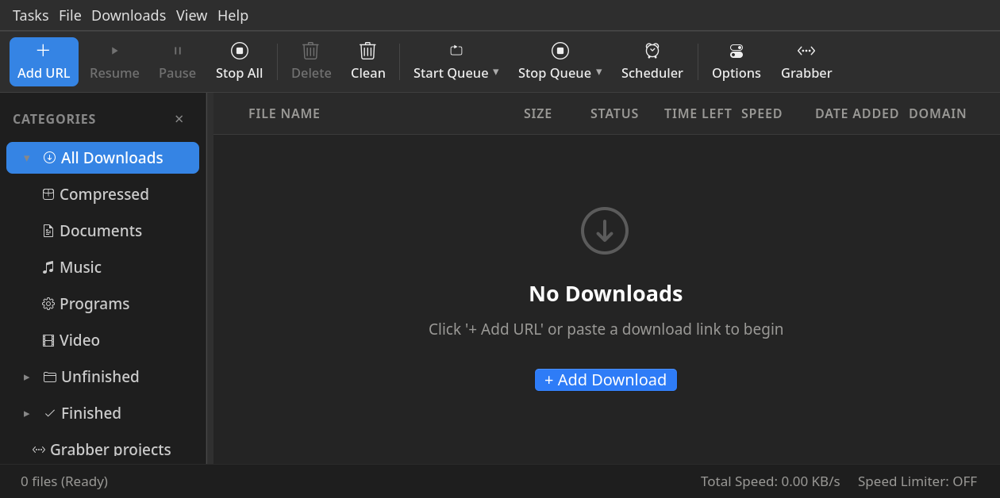
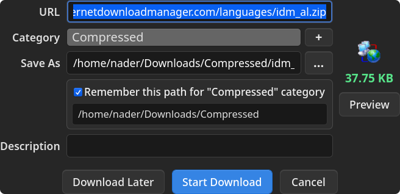
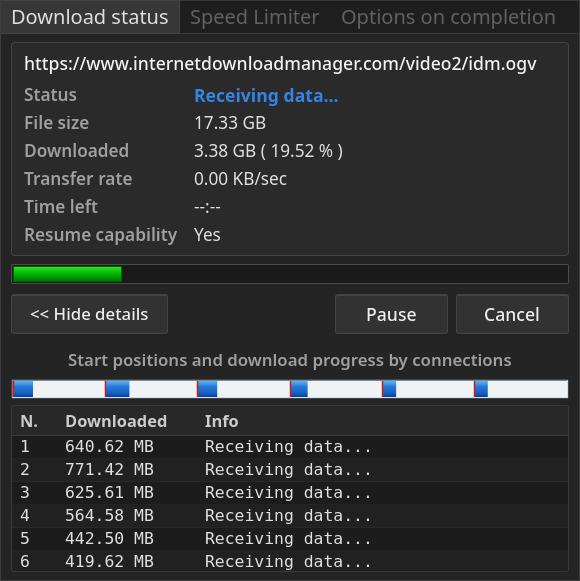

# OpenDM — High-Speed Download Accelerator for Linux

<div align="center">

[](https://en.wikipedia.org/wiki/C%2B%2B20)
[](https://www.gtk.org/)
[](LICENSE)
[](https://github.com/nadermkhan)
[](https://kernel.org)
[](tests/)
[-success.svg?style=for-the-badge)](SECURITY.md)

**A high-performance, native C++20 / GTK4 recreation of Internet Download Manager (IDM).**  
*Created by [Nader Mahbub Khan](https://github.com/nadermkhan).*

[Screenshots](#screenshots) • [Features](#features) • [Quick Start](#quick-start) • [Browser Integration](#browser-integration) • [Notice](#notice) • [License](#license--attribution)

</div>

---

## Notice

If you missing out anything or having bugs , please fix it yourself or modify it as you want , I am not obliged to develop it further on individual's request.

---

## Screenshots

<div align="center">

### Main Interface


### Download File Info Dialog


### Download Progress & Connection Visualizer


</div>

---

## Features

* **Dynamic Multipart Socket Segmentation**: Splits active downloads dynamically mid-flight up to 32 concurrent threads without connection teardown.
* **Browser Integration**: Native Messaging host compatible with Chromium (Chrome, Brave, Edge) and Firefox.
* **Pre-Download File Info Prompt**: Automatically inspects file size, categorizes destinations, and supports folder synchronization.
* **Remote ZIP Inspection**: Uses HTTP Range queries to read archive central directories and download individual files without fetching the entire archive.
* **Native ISOBMFF Muxer & fMP4 Defragmenter**: Multiplexes separate video and audio DASH streams into fast-start MP4 containers without external re-encoding.
* **Bandwidth Pacing**: Token-bucket speed limiting per session or globally across all downloads.
* **Batch Import & Queue**: Supports IDM `.ef2` batch files, text URL lists, and queue scheduling.
* **Zero Telemetry**: No tracking, no ads, no remote data collection.

---

## Quick Start

### 1. Install Dependencies

**Debian / Ubuntu / Linux Mint / Pop!_OS:**
```bash
sudo apt-get update
sudo apt-get install -y cmake ninja-build g++ pkg-config \
    libgtk-4-dev libcurl4-openssl-dev zlib1g-dev libssl-dev
```

**Fedora / RHEL:**
```bash
sudo dnf install cmake ninja-build gcc-c++ gtk4-devel libcurl-devel zlib-devel openssl-devel
```

**Arch Linux:**
```bash
sudo pacman -S cmake ninja gcc gtk4 curl zlib openssl
```

### 2. Build & Verify

```bash
git clone https://github.com/nadermkhan/opendm.git
cd opendm

cmake -B build -S . -G Ninja
cmake --build build -j$(nproc)
ctest --test-dir build --output-on-failure
```

### 3. Install Desktop Integration

```bash
./install_desktop.sh
```

This installs:
* Desktop launcher (`opendm.desktop`) and application icons.
* Command-line binaries: `~/.local/bin/opendm` and `~/.local/bin/opendm-native-host`.
* Native Messaging manifests for Chrome, Chromium, Brave, Edge, and Firefox.

---

## Browser Integration

1. Run `./install_desktop.sh` to install Native Messaging manifests.
2. In your browser (Chrome / Brave / Edge), navigate to `chrome://extensions/`.
3. Enable **Developer mode** (top right toggle).
4. Click **Load unpacked** and select the [`extension_extracted/`](extension_extracted/) directory from this repository.
5. In Firefox, navigate to `about:debugging#/runtime/this-firefox` and select **Load Temporary Add-on** pointing to `extension_extracted/manifest.json`.

---

## Command Line Usage

```bash
# Download with 16 connections
opendm -d https://speed.hetzner.de/100MB.bin -p ~/Downloads -c 16

# Add to queue without starting immediately
opendm -a -d https://speed.hetzner.de/100MB.bin -p ~/Downloads

# Apply speed limit (e.g. 500 KB/s)
opendm -d https://speed.hetzner.de/100MB.bin -l 500

# Import IDM batch file (.ef2)
opendm -i /path/to/downloads.ef2 -s

# Silent / Headless download
opendm -n -d https://example.com/archive.zip -p /tmp
```

---

## Project Structure

```
opendm/
├── src/
│   ├── core/         # ChunkManager, DownloadSession, MediaMuxer, ZipPreviewer
│   ├── ipc/          # Local IPC server and browser Native Messaging host
│   ├── ui/           # GTK4 user interface and custom widgets
│   └── main.cpp      # CLI argument parsing and GTK application entry point
├── tests/            # Automated Catch2/CTest suites
├── extension_extracted/ # Browser WebExtension
└── install_desktop.sh# Desktop installation script
```

---

## Author & Maintainer

* **Nader Mahbub Khan**
  * GitHub: [@nadermkhan](https://github.com/nadermkhan)
  * Email: muhammadnadermahbubkhan@gmail.com
  * Repository: [https://github.com/nadermkhan/opendm](https://github.com/nadermkhan/opendm)

---

## License & Attribution

* **License**: Licensed under the [GNU General Public License v3.0 (GPL-3.0)](LICENSE).
* **Attribution (GPL-3.0 Section 7)**: All distributions, copies, and forks must retain the [NOTICE](NOTICE) file and prominently credit the creator:  
  `Created by Nader Mahbub Khan (https://github.com/nadermkhan/opendm)`
* **Disclaimer**: OpenDM is an independent clean-room implementation. It is not affiliated with, endorsed by, or sponsored by Tonec Inc. Internet Download Manager (IDM) is a registered trademark of Tonec Inc.
