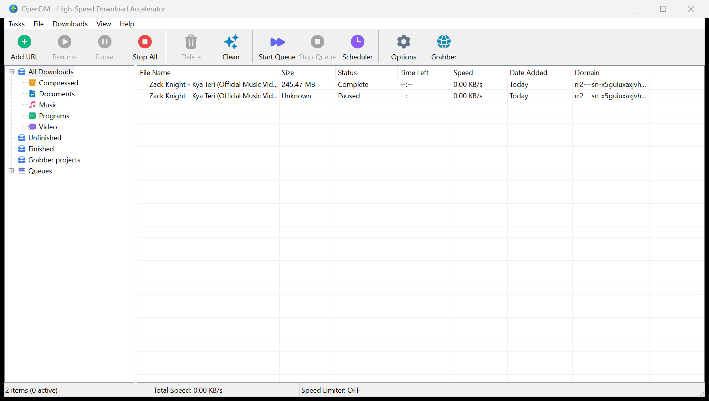
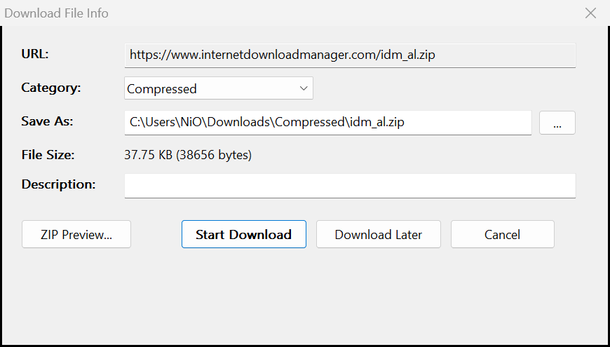
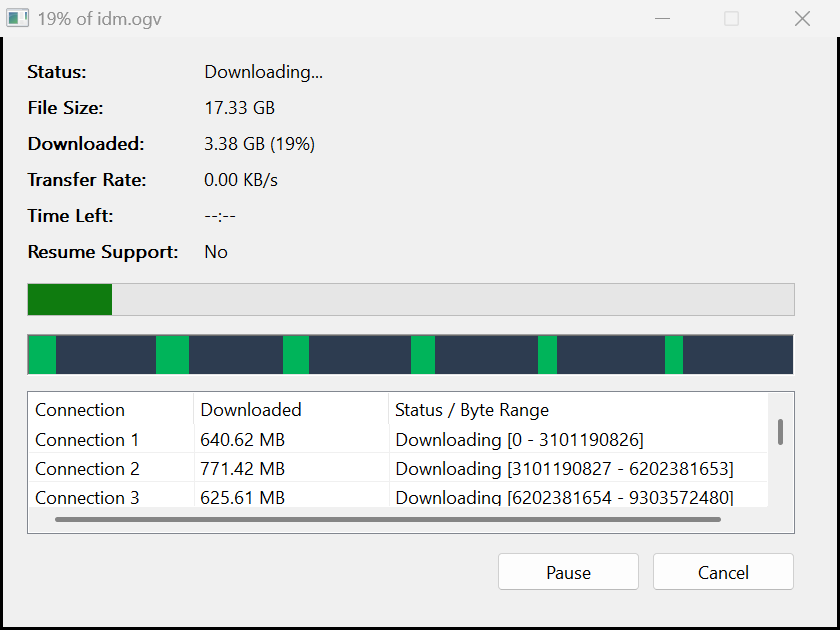
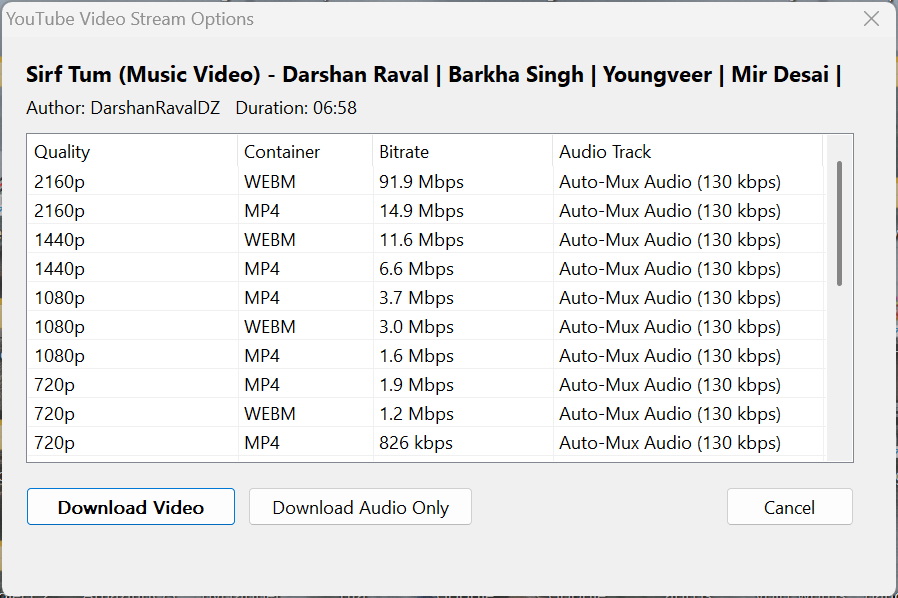
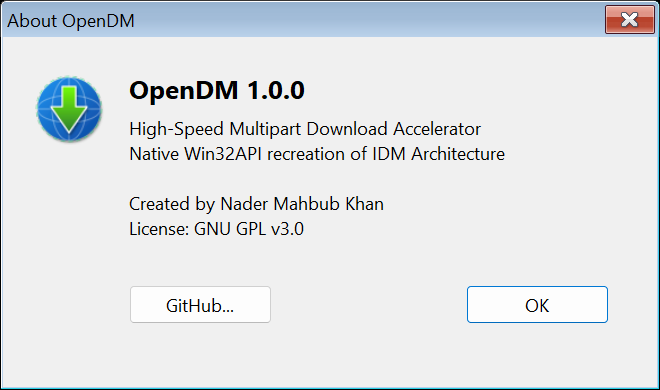
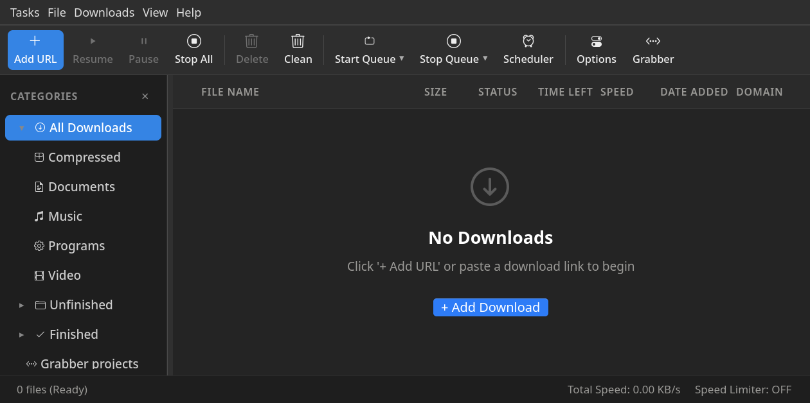
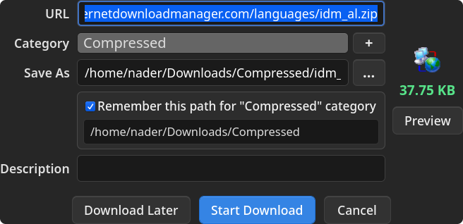
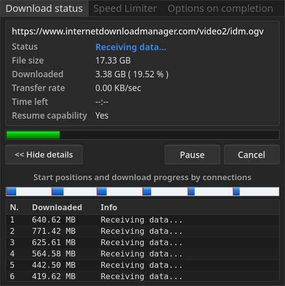

# OpenDM — Cross-Platform High-Speed Download Accelerator

<div align="center">

[](https://en.wikipedia.org/wiki/C%2B%2B20)
[](https://learn.microsoft.com/en-us/windows/win32/)
[](https://www.gtk.org/)
[](LICENSE)
[](https://github.com/nadermkhan)
[](#quick-start)
[](tests/)
[](.github/workflows/release.yml)
[-success.svg?style=for-the-badge)](SECURITY.md)

**A high-performance, native C++20 recreation of Internet Download Manager (IDM) for Windows (Win32 API) and Linux (GTK4).**  
*Created by [Nader Mahbub Khan](https://github.com/nadermkhan).*

[Screenshots](#screenshots) • [Features](#features) • [Quick Start](#quick-start) • [Browser Integration](#browser-integration) • [CLI Usage](#command-line-usage) • [License](#license--attribution)

</div>

---

## Overview

OpenDM is a clean-room, native C++20 download accelerator built with zero bloat and native OS toolkits:
* **Windows (10/11)**: Built directly on the **Win32 API**, **Common Controls v6**, **GDI+**, **Per-Monitor V2 High-DPI awareness**, and **Windows Named Pipes** (`\\.\pipe\opendm_pipe`) for IPC.
* **Linux**: Built on **GTK4** and **Unix Domain Sockets** for IPC.

Contributions, bug reports, and forks are welcome!

---

## Screenshots

<div align="center">

### Windows (Native Win32 API)

#### Main Interface


#### Download File Info Dialog


#### Download Progress & Multipart Connection Visualizer


#### YouTube Adaptive Video & Audio Stream Selector


#### About Dialog


---

### Linux (GTK4)

#### Main Interface


#### Download File Info Dialog


#### Download Progress & Connection Visualizer


</div>

---

## Features

* **Dynamic Multipart Socket Segmentation**: Splits active downloads dynamically mid-flight up to 32 concurrent threads without connection teardown, adhering to IDM's 204 KB minimum split threshold.
* **Adaptive YouTube & DASH Stream Engine**: Extracts adaptive video and audio streams with automatic container remuxing (MP4/WebM) so high-resolution video downloads include synchronized audio out of the box.
* **Native ISOBMFF Muxer & fMP4 Defragmenter**: Multiplexes separate video and audio streams into fast-start `[ftyp][moov][mdat]` MP4 containers in pure C++ (with optional FFmpeg fallback for WebM/VP9/Opus).
* **Native Cross-Platform GUI**:
  * **Windows**: Native Win32 controls (`WC_LISTVIEW`, `WC_TREEVIEW`, `WC_TABCONTROL`), custom GDI+ Heroicons/3D toolbar rendering, Per-Monitor V2 DPI scaling, flicker-free delta list updates, and non-blocking asynchronous session teardown.
  * **Linux**: Native GTK4 interface with custom CSS styling and responsive widgets.
* **Browser Integration**: Native Messaging host (`opendm-native-host`) compatible with Chromium (Chrome, Brave, Edge) and Firefox, featuring thread-safe UI prompt marshaling.
* **Pre-Download File Info Prompt**: Automatically inspects file size, categorizes destinations (`Compressed`, `Documents`, `Music`, `Programs`, `Video`), and supports folder synchronization.
* **Remote ZIP Inspection**: Uses HTTP Range queries to read archive central directories and selectively extract individual files without fetching the entire archive.
* **Site Grabber & Crawler**: Multi-depth website link spider with domain filtering and content-type rules.
* **Bandwidth Pacing**: Token-bucket speed limiting per session or globally across all active downloads.
* **Batch Import & Queue Scheduler**: Supports IDM `.ef2` batch files, text URL lists, and automated queue scheduling.
* **Zero Telemetry**: No tracking, no ads, no remote data collection.

---

## Quick Start

### Windows (MSYS2 / MinGW-w64)

#### 1. Install Dependencies
Open an **MSYS2 MinGW64** shell and install the toolchain and required libraries:
```bash
pacman -S --needed mingw-w64-x86_64-toolchain \
    mingw-w64-x86_64-cmake \
    mingw-w64-x86_64-ninja \
    mingw-w64-x86_64-curl \
    mingw-w64-x86_64-zlib \
    mingw-w64-x86_64-nlohmann-json
```

#### 2. Build & Verify
```powershell
git clone https://github.com/nadermkhan/opendm.git
cd opendm

cmake -B build -S . -G Ninja -DCMAKE_PREFIX_PATH=C:/msys64/mingw64
cmake --build build -j
ctest --test-dir build --output-on-failure
```

#### 3. Run
```powershell
.\build\opendm.exe
```

---

### Linux (GTK4)

#### 1. Install Dependencies

**Debian / Ubuntu / Linux Mint / Pop!_OS:**
```bash
sudo apt-get update
sudo apt-get install -y cmake ninja-build g++ pkg-config \
    libgtk-4-dev libcurl4-openssl-dev zlib1g-dev libssl-dev nlohmann-json3-dev
```

**Fedora / RHEL:**
```bash
sudo dnf install cmake ninja-build gcc-c++ gtk4-devel libcurl-devel zlib-devel openssl-devel json-devel
```

**Arch Linux:**
```bash
sudo pacman -S cmake ninja gcc gtk4 curl zlib openssl nlohmann-json
```

#### 2. Build & Verify
```bash
git clone https://github.com/nadermkhan/opendm.git
cd opendm

cmake -B build -S . -G Ninja
cmake --build build -j$(nproc)
ctest --test-dir build --output-on-failure
```

#### 3. Install Desktop Integration (Linux)
```bash
./install_desktop.sh
```
This installs:
* Desktop launcher (`opendm.desktop`) and application icons.
* Command-line binaries: `~/.local/bin/opendm` and `~/.local/bin/opendm-native-host`.
* Native Messaging manifests for Chrome, Chromium, Brave, Edge, and Firefox.

---

## Browser Integration

1. **Linux**: Run `./install_desktop.sh` to install the Native Messaging manifests automatically.  
   **Windows**: Register the Native Messaging host manifest (`data/native-messaging/com.tonec.idm.chrome.json` or `com.tonec.idm.firefox.json`) pointing to `opendm-native-host.exe` under `HKCU\Software\Google\Chrome\NativeMessagingHosts\com.tonec.idm` (or Mozilla's equivalent registry key).
2. In your Chromium browser (Chrome / Brave / Edge), navigate to `chrome://extensions/`.
3. Enable **Developer mode** (top-right toggle).
4. Click **Load unpacked** and select the [`extension_extracted/`](extension_extracted/) directory from this repository.
5. In Firefox, navigate to `about:debugging#/runtime/this-firefox` and select **Load Temporary Add-on** pointing to `extension_extracted/manifest.json`.

---

## Command Line Usage

```bash
# Download with 16 connections
opendm -d https://speed.hetzner.de/100MB.bin -p ~/Downloads -c 16

# Add to queue without starting immediately
opendm -a -d https://speed.hetzner.de/100MB.bin -p ~/Downloads

# Apply speed limit (e.g. 500 KB/s)
opendm -d https://speed.hetzner.de/100MB.bin -l 500

# Import IDM batch file (.ef2)
opendm -i /path/to/downloads.ef2 -s

# Silent / Headless download
opendm -n -d https://example.com/archive.zip -p /tmp
```

---

## Project Structure

```
opendm/
├── src/
│   ├── core/               # ChunkManager, DownloadSession, DownloadQueue,
│   │                       # MediaMuxer, YouTubeEngine, DashParser, ZipPreviewer
│   ├── ipc/                # Named Pipe (Win32) & Unix Socket (Linux) IPC server
│   │                       # and Browser Native Messaging host
│   ├── cli/                # Command-line interface parser
│   ├── ui_win32/           # Native Windows Win32 API GUI, Common Controls v6,
│   │                       # GDI+ icon renderer, and Per-Monitor V2 DPI helpers
│   ├── ui/                 # Linux GTK4 user interface and custom widgets
│   └── main.cpp            # Cross-platform CLI and GUI application entry point
├── data/                   # Application icons, Win32 manifest, and UI assets
├── tests/                  # Automated CTest suites (7/7 passing)
├── extension_extracted/    # Browser WebExtension (Chrome / Edge / Brave / Firefox)
└── install_desktop.sh      # Linux desktop & native host installation script
```

---

## Author & Maintainer

* **Nader Mahbub Khan**
  * GitHub: [@nadermkhan](https://github.com/nadermkhan)
  * Email: muhammadnadermahbubkhan@gmail.com
  * Repository: [https://github.com/nadermkhan/opendm](https://github.com/nadermkhan/opendm)

---

## License & Attribution

* **License**: Licensed under the [GNU General Public License v3.0 (GPL-3.0)](LICENSE).
* **Attribution (GPL-3.0 Section 7)**: All distributions, copies, and forks must retain the [NOTICE](NOTICE) file and prominently credit the creator:  
  `Created by Nader Mahbub Khan (https://github.com/nadermkhan/opendm)`
* **Disclaimer**: OpenDM is an independent clean-room implementation. It is not affiliated with, endorsed by, or sponsored by Tonec Inc. Internet Download Manager (IDM) is a registered trademark of Tonec Inc.
