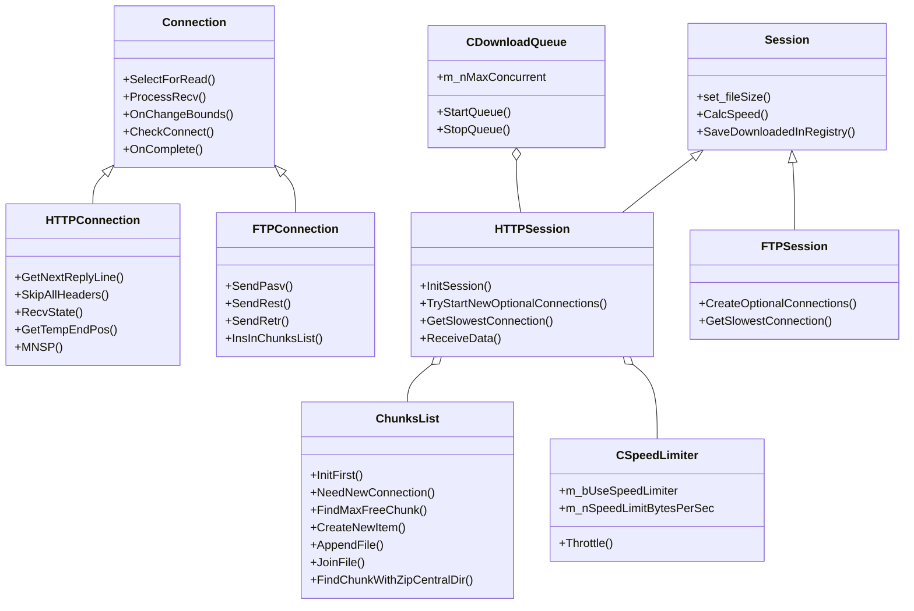

# Comprehensive Reverse Engineering Analysis of Internet Download Manager (IDM v6.43.15)

## 1. Executive Summary & Binary Breakdown

Internet Download Manager (IDM) is a proprietary Windows download accelerator and stream capturer. Analysis of the shipped package `idman643build15.exe` using REA (`morluto/rea`), PE parsers, and disassembly tools reveals a multi-tiered architecture:

```
+------------------------------------------------------------------------------------+
|                             idman643build15.exe                                    |
|                      (Custom Inno/Tonec PE32 Installer)                            |
+------------------------------------------------------------------------------------+
                                       |
       +-------------------------------+-------------------------------+
       |                               |                               |
       v                               v                               v
+------------------+          +-------------------+          +-------------------+
|    IDMan.exe     |          |  IDMMsgHost.exe   |          | Browser Add-ons   |
| (Main Executable)|          | (Native Msg Host) |          | (CRX & XPI Exts)  |
|  - ChunksList    |          +-------------------+          +-------------------+
|  - HTTPSession   |                   |                               |
|  - SpeedLimiter  |<--- Named Pipe ---+<------ Native Messaging ------+
|  - Queues/Sched  |    (\\.\pipe\IDMNetworkMonitor)
+------------------+
       |
       +------------> IDMVMPrs.dll (libxml2-based MPD/HLS manifest parser)
       +------------> idmvconv.dll (TS, AAC, MP4, MKV remuxing engine)
       +------------> libcrypto.dll & libssl.dll (OpenSSL TLS 1.2 / 1.3)
```

### Binary Artifacts Inventory
* **`idman643build15.exe`** (12.56 MB): PE32 Intel i386 executable wrapper with a custom zlib-compressed archive starting at byte offset `95232`.
* **`IDMan.exe`** (6.20 MB, RVA base `0x400000`): The core download manager application, written in C++ with MFC runtime, compiled with MSVC.
* **`IDMMsgHost.exe`** (74 KB): Standard I/O Native Messaging Host bridging Chromium/Firefox browsers to `IDMan.exe` via Windows Named Pipe `\\.\pipe\IDMNetworkMonitor`.
* **`IDMVMPrs.dll`** (337 KB): Embedded `libxml2` video/audio media parser supporting MPEG-DASH (`.mpd`) and Apple HLS (`.m3u8`).
* **`idmvconv.dll`** (855 KB): Standalone multimedia muxing and conversion library implementing container transformations (TS+AAC to MP4, MKV muxing, WebM audio normalization).
* **`IDMGCExt.crx` / `idmmzcc3.xpi`**: WebExtensions implementing DOM inspection, video sniffer, floating action download panels, and WebRequest interception.

---

## 2. Installer Package Format & Unpacking Algorithm

The installer does not use standard 7-Zip, NSIS, or Inno Setup formats. It is a proprietary Tonec packaging scheme:

1. **PE Executable Stub** (0 to 95,231 bytes): Native 32-bit GUI executable (`installer.exe`).
2. **Payload Block 0: Manifest** (starts at offset `95232`):
   * 32-byte header:
     - `uint32_t uncompressed_size` (e.g., `0x4809` = 18,441 bytes)
     - `uint32_t compressed_size` (e.g., `0x08EE` = 2,286 bytes)
     - `FILETIME creation_time`, `FILETIME access_time`, `FILETIME write_time` (24 bytes)
   * Followed immediately by `compressed_size` bytes of raw zlib (deflate header `0x78 0xDA`).
   * The decompressed payload is an INI/XML-like plain-text manifest with entries `<LNK#=...<P#="filepath">` describing 191 target files and registry actions.
3. **Payload Blocks 1 to 191**:
   * Each file is sequentially stored with the identical 32-byte header followed by its zlib-deflated stream matching the corresponding `LNK#` entry from the manifest.

---

## 3. Core Architecture & RTTI Class Hierarchy

Deep RTTI reconstruction identified 361 C++ classes in `IDMan.exe`. The core hierarchy is structured as follows:



---

## 4. Dynamic Multi-Part Segmentation Engine (`ChunksList`)

Unlike traditional segmented downloaders that divide a file into fixed equal slices at the start (e.g. 0-25MB, 25-50MB, etc.), IDM uses a **dynamic workload balancing algorithm**:

### 4.1 Data Structure
* `ChunksList` contains a linked list of chunk descriptors (`head = [this + 0x88]`, `next = [item + 0x58]`).
* Each chunk descriptor tracks:
  - `start_offset` (`int64_t`, offset `0x60`)
  - `end_offset` (`int64_t`, offset `0x78`)
  - `downloaded_bytes` (`int64_t`, offset `0x80`)
  - `current_speed` (`uint32_t`, bytes/sec at offset `0x98`)
  - `status_flag` (offset `0x14`): 0 = In Progress, 1 = Completed, 2 = Reserved
  - Temporary file handle / path on disk.

### 4.2 Algorithm: `ChunksList::FindMaxFreeChunk` (`0x559B30`)
1. Loops through all chunk nodes in `[this + 0x88]`.
2. Skips chunks that are already completed (`status != 0`).
3. For active chunks, calculates remaining un-downloaded bytes:
   $$\text{Remaining} = (\text{end\_offset} - \text{start\_offset} - \text{downloaded\_bytes} + 1) - (\text{speed} \times \text{estimated\_lag})$$
4. Retains the chunk pointer with the highest remaining byte count.

### 4.3 Algorithm: `ChunksList::NeedNewConnection` (`0x55AE80`)
1. Inquires `FindMaxFreeChunk()`.
2. Retrieves configured minimum chunk threshold:
   $$\text{MinChunkSize} = 102,400\text{ bytes (100 KB)}$$
3. Checks condition:
   $$\text{FreeBytes} \ge 2 \times \text{MinChunkSize} + 3$$
4. If free bytes $< 204,800$ bytes, returns `FALSE` (splitting would introduce TCP connection overhead with no throughput benefit).
5. If free bytes $\ge 204,800$ bytes, returns `TRUE` (warrants spawning a new connection).

### 4.4 Algorithm: Dynamic Sub-Chunk Carving (`CreateNewItem` & `OnChangeBounds`)
1. Given target chunk $C_i = [\text{start}_i, \text{end}_i]$ currently being downloaded by Connection $k$:
2. Determines split boundary:
   $$\text{split\_offset} = \text{start}_i + \text{downloaded}_i + \left\lfloor \frac{\text{Remaining}_i}{2} \right\rfloor$$
3. Dynamically truncates existing chunk $C_i$:
   $$\text{end}_i^{\text{new}} = \text{split\_offset} - 1$$
   Sends socket buffer bound adjustment (`Connection::OnChangeBounds`) without closing socket $k$.
4. Creates new chunk $C_{i+1}$:
   $$\text{start}_{i+1} = \text{split\_offset},\quad \text{end}_{i+1} = \text{end}_i^{\text{orig}},\quad \text{downloaded}_{i+1} = 0$$
5. Spawns new thread/socket requesting:
   `Range: bytes=<split_offset>-<end_orig>`
   and saving into temporary part file `<filename>.part<idx>`.

### 4.5 Algorithm: `ChunksList::JoinFile` & `AppendFile` (`0x561BD0`)
1. Waits until all chunks in `ChunksList` report `status == 1` (`downloaded == (end - start + 1)`).
2. Creates or opens the destination file `<output_path>`.
3. Sequentially iterates through chunks sorted by `start_offset`:
   - Opens temporary part file `<temp_dir>/<file>.part<N>`.
   - Streams bytes in 64 KB buffers from part file and writes to output file.
   - Emits UI progress message `WM_COMMAND 0x147D` ("Assembling... X%").
   - Closes and unlinks/deletes the temporary chunk file.
4. Flushes file buffers via `FlushFileBuffers` and sets timestamps (`SetFileTime`).

---

## 5. Networking Protocols & Transport Layer

### 5.1 HTTP / HTTPS Engine
* **Range Negotiation**:
  - Sends initial probe request: `GET <URL> HTTP/1.1` with `Range: bytes=0-` or `Range: bytes=0-0`.
  - Checks response status:
    * `206 Partial Content` + `Content-Range: bytes 0-X/Total`: Resumable and supports multi-part connections!
    * `200 OK` (ignores Range): Non-resumable server. IDM forces single-connection mode (`max_connections = 1`), streaming linearly into destination.
* **Keep-Alive & Connection Re-use**:
  - `Connection: keep-alive` retained across requests to the same origin.
* **TLS 1.2 / 1.3**:
  - Dynamically loads `libcrypto.dll` and `libssl.dll` (OpenSSL). Configures ALPN, SNI, and cipher suites.
* **Authentication**:
  - Basic: `Authorization: Basic <base64>`
  - Digest: RFC 2617 `Authorization: Digest username=..., realm=..., nonce=..., uri=..., response=...`
  - NTLM/Kerberos negotiation via Windows SSPI where applicable.

### 5.2 FTP Engine (`FTPConnection`)
* Supports active mode (`PORT`) and passive mode (`PASV`).
* Discovers file size via `SIZE <filename>`.
* Resumes via `REST <byte_offset>` followed by `RETR <filename>`.
* Discovers modification time via `MDTM <filename>`.

### 5.3 Proxy Support
* Supports Direct, System Proxy, PAC scripts (`jsproxy.dll`), HTTP Proxies, and SOCKS4 / SOCKS5 with remote DNS resolution (`Socks5ProxyDNS`).

---

## 6. Video Stream Sniffing & Remuxing Architecture

### 6.1 Browser Extension (`background.js` & `content.js`)
* **DOM Video Tag Observer**:
  - Uses `MutationObserver`, `IntersectionObserver`, and `ResizeObserver` to track all `<video>`, `<audio>`, `<object>`, and `<iframe>` elements.
  - Resolves bounding box rectangles (`GetBoundingClientRect()`) and calculates viewport visibility.
  - Forwards element coordinates to `IDMan.exe` to position the floating "Download this video" button.
* **Network Sniffer**:
  - Intercepts requests using `chrome.webRequest` / Firefox WebRequest.
  - Matches video MIME types and patterns:
    * HLS: `application/vnd.apple.mpegurl`, `application/x-mpegurl`, `.m3u8`
    * MPEG-DASH: `application/dash+xml`, `video/vnd.mpeg.dash.mpd`, `.mpd`
    * Adobe HDS: `application/f4m+xml`, `.f4m`, `.f4f`
    * Direct streams: `.mp4`, `.m4s`, `.webm`, `.ts`, `.flv`

### 6.2 Stream Parser (`IDMVMPrs.dll`)
* Parses M3U8 Master playlists and Media playlists.
* Parses MPEG-DASH XML manifests using embedded `libxml2` (`Parse1`, `GetMPDParserInfo`):
  - Extracts `<Period>`, `<AdaptationSet>`, `<Representation>` (audio vs video tracks).
  - Resolves `$Number$` and `$Time$` segment template URLs.
  - Downloads video track (e.g. 1080p video-only) and audio track (e.g. AAC audio-only) separately.

### 6.3 Multimedia Remuxer (`idmvconv.dll`)
* Exports 15 functions including:
  - `ConvertTsAndAACToMp4_withProgress2`: Converts MPEG-TS transport stream and raw AAC audio to ISO MP4 without re-encoding.
  - `ConvertTsToMp4`: Repackages MPEG-TS container into standard MP4.
  - `MuxMP4AndMKVToMKV`: Combines separate video and audio streams into Matroska (.mkv) container.
  - `NormalizeWebmAudioStream_withProgress`: Fixes Opus/Vorbis timestamps and WebM clusters.

---

## 7. Browser Integration & Native Messaging Protocol

Communication between the Chrome/Firefox browser extension and `IDMan.exe` flows through `IDMMsgHost.exe`:

1. **Extension to `IDMMsgHost.exe`**:
   Standard WebExtensions Native Messaging over stdin/stdout with 4-byte little-endian message length prefix followed by UTF-8 string.
2. **`IDMMsgHost.exe` to `IDMan.exe`**:
   Windows Named Pipe `\\.\pipe\IDMNetworkMonitor`.
3. **Wire Protocol Structure**:
   `MSG#<seq_id>#<type>#<sub_type>#<flags>:<param1>:<param2>,<field_id>=<len>:<data>;`
   * Fields include:
     - `6`: Download URL
     - `50`: Referer URL
     - `51`: Cookie header
     - `54`: User-Agent string
     - `100`: Suggested filename
     - `121`/`122`: Proxy configuration
     - `127`: MIME type

---

## 8. Speed Limiter & Bandwidth Throttling

* Controlled by `bUseSpeedLimiter` and `m_nSpeedLimitBytesPerSec`.
* **Token Bucket / Delta Calculation** (`0x5BAE40`):
  1. Records interval timestamp using high-resolution timer (`delta_ms = now - last_time`).
  2. Measures received bytes in interval: `delta_bytes = bytes_now - bytes_last`.
  3. Computes instantaneous speed: $\text{Rate} = \frac{\text{delta\_bytes} \times 1000}{\text{delta\_ms}}$.
  4. If $\text{Rate} > \text{Limit}$, computes required delay:
     $$\text{delay\_ms} = \left( \frac{\text{delta\_bytes} \times 1000}{\text{Limit}} \right) - \text{delta\_ms}$$
  5. Suspends socket read loop (`SleepEx(delay_ms, TRUE)`) to maintain steady throughput.

---

## 9. Scheduler & Download Queues

* **Queues**:
  - "Default Download Queue": General sequential/parallel queue.
  - "Default Synchronization Queue": Checks file timestamps/sizes on remote servers and re-downloads only modified files.
  - User-defined queues: Custom limits for concurrent active connections.
* **Scheduling Triggers**:
  - Daily start and stop times.
  - Number of retry attempts on network error.
  - Automated post-completion actions: exit application, disconnect network interface, system power off.

---

## 10. CLI Reference Map

| Parameter | Function | Equivalent IDM Action |
|:---|:---|:---|
| `/d <URL>` | Download URL | Opens download for specified URL |
| `/p <path>` | Save path | Sets destination directory |
| `/f <filename>` | Local file name | Overrides destination file name |
| `/s` | Start queue | Starts processing scheduled queue |
| `/q` | Exit on complete | Quits IDM after download completes |
| `/h` | Hangup / disconnect | Disconnects network after completion |
| `/n` | Silent mode | Adds/starts without showing confirmation dialogs |
| `/a` | Add to queue | Queues download without starting immediately |

---

## 11. Remote ZIP Content Preview Algorithm (`CZipFormat` & `CFile_Header`)

IDM allows users to preview files inside remote `.zip` archives and download individual files without fetching the entire archive.

### 11.1 ZIP Specification Exploitation via HTTP Range
A ZIP file places its master file table—the **Central Directory**—at the **end** of the archive:
```
[Local File Header 1 + Compressed Payload 1]
[Local File Header 2 + Compressed Payload 2]
...
[Central Directory Header 1 (PK\x01\x02)]
[Central Directory Header 2 (PK\x01\x02)]
[End of Central Directory Record - EOCD (PK\x05\x06)]
```

### 11.2 The Backward Scanning Algorithm
1. **Fetch Tail**: IDM issues a partial content request for the last 65,536 bytes (the maximum possible length of an EOCD record including comments):
   ```http
   GET /archive.zip HTTP/1.1
   Range: bytes=-65536
   ```
2. **Locate EOCD (`0x06054b50`)**:
   Scans backward from byte `offset = tail_length - 22` searching for the 4-byte signature `PK\x05\x06`.
3. **Parse Central Directory Geometry**:
   - `total_entries`: uint16 at `eocd + 10`
   - `central_dir_size`: uint32 at `eocd + 12`
   - `central_dir_offset`: uint32 at `eocd + 16`
4. **Fetch Full Central Directory**:
   If `central_dir_offset` precedes the initial 64 KB tail window, IDM sends a second targeted Range request:
   ```http
   Range: bytes=<central_dir_offset>-<central_dir_offset + central_dir_size - 1>
   ```
5. **Parse `CFile_Header` Records (`PK\x01\x02`)**:
   Iterates through each entry extracting:
   - `compression_method` (0 = Stored, 8 = Deflated)
   - `compressed_size`
   - `uncompressed_size`
   - `relative_offset_of_local_header`
   - `filename`
6. **Selective Extraction**:
   When the user chooses to extract a single file, IDM requests:
   ```http
   Range: bytes=<local_header_offset>-<local_header_offset + 30 + fname_len + extra_len + compressed_size - 1>
   ```
   The downloaded stream is inflated using zlib in memory and saved to disk.

---

## 12. Media Stream Parsing Engine (`IDMVMPrs.dll`)

* **Internal Exports**:
  - `GetMPDParserInfo` (`0x10001ed0`)
  - `Parse1` (`0x10002fc0`)
  - 640+ exported functions from statically linked `libxml2` (`xmlReadMemory`, `xmlSAX2StartElementNs`, etc.)
* **DASH Processing Mechanism**:
  1. Receives an MPEG-DASH XML manifest (`.mpd`).
  2. Parses `<Period>`, `<AdaptationSet>`, and `<Representation>` elements.
  3. Matches audio representations (`codecs="mp4a.*"`) and video representations (`codecs="avc1.*"` or `"vp9"`).
  4. Resolves `<SegmentTemplate>` patterns (`$Number$` or `$Time$`) against `initialization` and `media` URI templates.
  5. Schedules sequential or multi-part downloads of initialization headers followed by media segments.

---

## 13. Media Remuxing & Conversion Engine (`idmvconv.dll`)

* **Internal Library**: `IDMmkvlib0.1` and custom ISOBMFF MP4 muxer.
* **Key Exported Routines**:
  - `ConvertTsAndAACToMp4_withProgress2` (`0x1001a3d0`): Merges separate H.264 Transport Stream (.ts) video and raw ADTS AAC audio into a standard MP4 file.
  - `ConvertTsToMp4` / `ConvertTsToMp4_withProgress` (`0x1001a860`): Direct remuxing of MPEG-TS containers to MP4.
  - `ConvertFlvToMp4` (`0x100191f0`): Unpacks FLV tag payloads and re-encapsulates into MP4.
  - `MuxMKVAndMKVToMKV` / `MuxMP4AndMKVToMKV` (`0x1001bb50`): Matroska stream interleaving.
  - `NormalizeWebmAudioStream_withProgress` (`0x1001bcf0`): Opus/Vorbis track normalization in WebM.
* **Muxing Without Re-Encoding**:
  - Dissects MPEG-TS packets (188 bytes, sync byte `0x47`).
  - Extracts H.264 NALUs to populate `avcC` (AVCDecoderConfigurationRecord: SPS and PPS arrays).
  - Unpacks ADTS AAC frames (7 or 9-byte headers) to extract raw AudioSpecificConfig into `mp4a` / `esds`.
  - Builds index atom tables: `stts` (time-to-sample), `stss` (sync sample keyframes), `stsc` (sample-to-chunk), and `stsz` (sample sizes).

---

## 14. Site Grabber Spider Architecture (`IDMGrHlp.exe`)

* **Binary Type**: 32-bit GUI helper executable linking `urlmon.dll` and `ole32.dll`.
* **DOM Traversal & JavaScript Execution**:
  - Embeds `CHiddenWebBrowser` using Microsoft COM `CWebBrowser2`.
  - Implements `IOleClientSite` and `IDispatch` to listen for `DISPID_NAVIGATECOMPLETE2` and `DISPID_DOCUMENTCOMPLETE`.
  - Executes scripts on target pages so dynamically rendered links (AJAX/Single-Page Apps) become visible.
* **HTML Parsing (`CIDMHTMLParser`)**:
  - Traverses the MSHTML DOM tree: `<a>`, ``, `<video>`, `<audio>`, `<link>`, `<script>`, `<source>`, `<iframe`.
  - Resolves relative URLs to canonical absolute URIs using `CoInternetCombineUrl`.
  - Populates `CFoundFilesArray` of `GRHLP_FOUNDFILEINFO` structures.
* **Recursion & Project State**:
  - Maintains a visited URL bloom filter / hash map.
  - Enforces project rules:
    - Maximum crawl depth level ($0$ to $N$).
    - Host domain boundaries (stay on domain, accept subdomains, or any domain).
    - File extension filter masks (e.g. `*.jpg`, `*.pdf`, `*.mp4`).
  - Stores project state in `Software\DownloadManager\GrabberSts\Projects`.

---

## 15. Browser Video Download Overlay Bar (`idmbrbtn.dll`)

* **Injected Library**: 32-bit and 64-bit hook DLL (`idmbrbtn.dll`, `idmbrbtn64.dll`).
* **Exported Entry Points**:
  - `CreateIDMButton` (`0x10003540`)
  - `CreateIDMButton2` (`0x10003240`)
  - `CreateIDMButton3` (`0x10002e80`)
  - `CreateDownlSelWtIDMButton` (`0x10003600`)
  - `SetIDMButtonValue3` (`0x100031a0`)
* **Detection & Overlay Logic**:
  - In modern browsers (Chrome/Firefox), `content.js` scans DOM for `<video>` and `<audio>` elements or observes network requests via `chrome.webRequest.onHeadersReceived` matching media MIME types (`video/*`, `audio/*`, `application/x-mpegurl`, `application/dash+xml`).
  - Calls native host `IDMMsgHost.exe` passing the video stream URL, available resolutions (720p, 1080p, 4K), audio bitrates, and video title.
  - In native mode, creates a floating Win32 popup window positioned directly over the media element rectangle offering *"Download this video"*.
